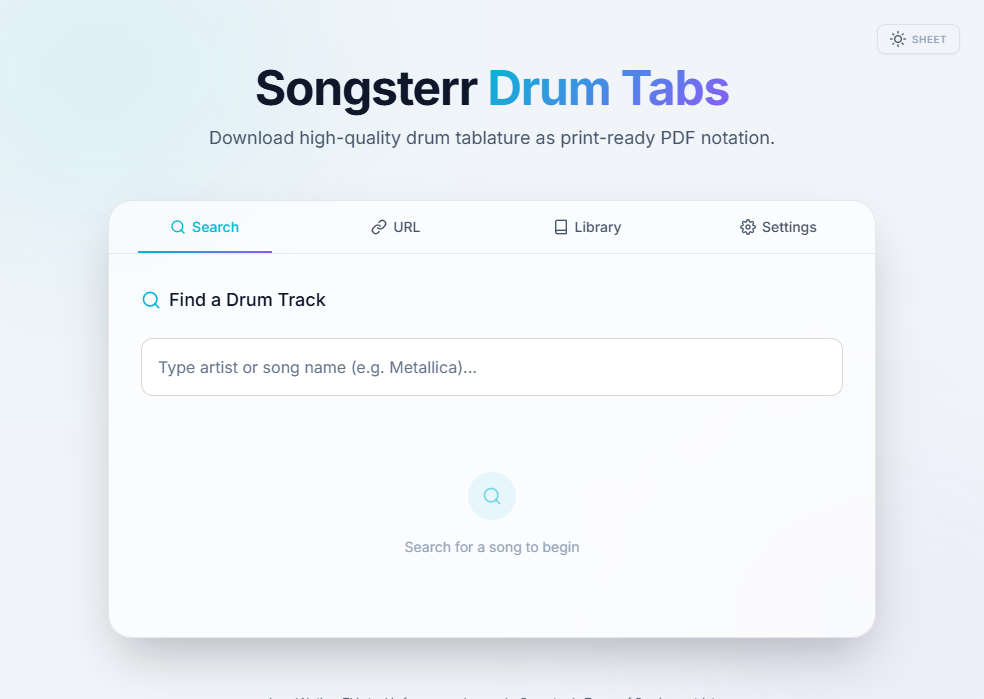
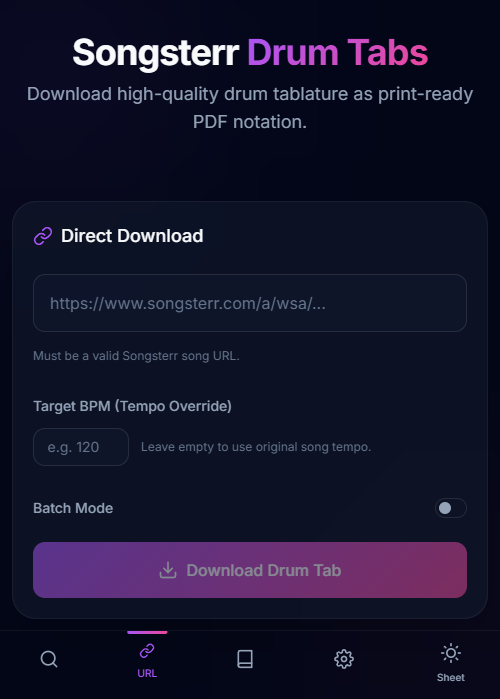
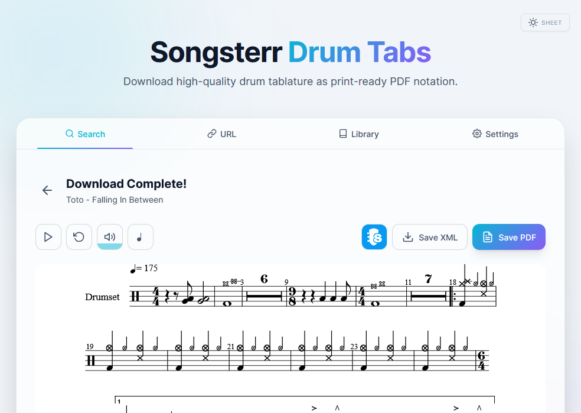
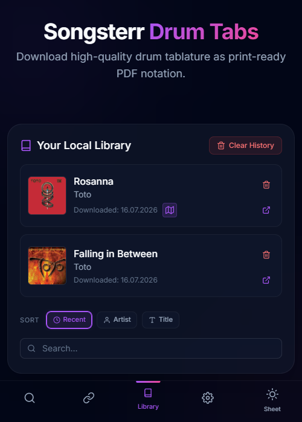

<div align="center">
  
  
  # Songsterr Drum Tab Downloader
  
  <p>
    <strong>A user-friendly tool for extracting, rendering, and downloading drum tablature from Songsterr.</strong>
  </p>
  
  <p>
    <a href="#why-i-built-this">Motivation</a> •
    <a href="#features">Features</a> •
    <a href="#getting-started">Getting Started</a> •
    <a href="#legal-notice">Legal Notice</a>
  </p>
</div>

<br />

<div align="center">
  
  
  <br/>
  
  
</div>

<br />

## Why I Built This

I was fed up looking for drum sheet music online. It's incredibly hard to find websites that offer easily downloadable transcriptions *(huge shoutout to Rob Ferrell and his amazing [free drum transcriptions website](https://robertferrell.com/free-drum-transcriptions.html)!)*. 

Most of the time, the only easily accessible transcriptions are found on Songsterr. While Songsterr is a great platform, its player isn't ideal if you prefer to practice using dedicated sheet music apps like **forScore**, or if you just want to print out the score on physical paper to take to the drum kit. 

I built this tool to bridge that gap. It lets you download the drum tracks directly from Songsterr and formats them perfectly into ready-to-use PDFs, giving you the freedom to practice *your* way, without needing a premium account. 

**Absolutely no login required, neither here nor on Songsterr.**

## Features

- **Clean & Responsive UI**: A gorgeous, modern web interface that looks and feels like a native app.
- **Mobile Optimized & PWA Ready**: Install the app directly to your phone's home screen. The UI is completely optimized for mobile devices, providing a seamless experience whether you are at your desk or at the drum kit.
- **Search & Filter**: Built-in search that automatically filters out songs that don't have drum tracks!
- **Interactive Visual Mapping**: Sometimes drum tracks use non-standard MIDI notation. The app detects this and lets you easily configure drum mappings via a simple, easy-to-use drag-and-drop staff interface.
- **In-Browser Sheet Music Rendering**: Instantly preview the downloaded drum tab inside your browser before downloading.
- **Native PDF Export**: Generates high-resolution PDF sheet music directly, ensuring perfect notation alignment.
- **Custom PDF Styling**: Adjust page format (A4/Letter, Portrait/Landscape), zoom scale, and toggle headers/measure numbers to perfectly format your exported sheet music *the way YOU like*.
- **Local Library History**: Automatically tracks and caches your download history in the browser for instant one-click access.
- **Batch Processing**: Paste a list of URLs to sequentially download multiple tabs automatically.
- **BPM Override**: Set a custom tempo for playback and notation directly from the settings panel.

## Getting Started

### Local Setup

**Prerequisites:** Python 3.11+ is recommended.

1. **Clone the repository:**
   ```bash
   git clone https://github.com/yourusername/songsterr-drum-tab-downloader.git
   cd songsterr-drum-tab-downloader
   ```

2. **Install the dependencies:**
   ```bash
   pip install -r requirements.txt
   ```

3. **Start the Flask server:**
   ```bash
   python app.py
   ```

4. Open your web browser and navigate to `http://localhost:5000`.

## Deployment

### Recommended: Docker

If you are running this on a home server, deploying with Docker is the easiest method. 

The provided `docker-compose.yml` defaults to pulling my pre-built image from `ghcr.io/ryoshoru/songsterrdrumtabdownloader:latest`. This provides a zero-setup experience that automatically updates if you use tools like Watchtower. 

**Want to build it yourself?**
If you plan on modifying the code, simply open `docker-compose.yml` and replace the `image:` line with `build: .` like so:

```yaml
services:
  songsterr-downloader:
    # image: ghcr.io/ryoshoru/songsterrdrumtabdownloader:latest
    build: .
    container_name: songsterr-downloader
```

This tells Docker to build the image from your local files instead.

1. Clone or download this repository to your server.
2. Open a terminal in the project directory.
3. Start the container in the background:
   ```bash
   docker compose up -d
   ```
4. Access the web interface at `http://<YOUR_SERVER_IP>:5000`.

### Advanced: PWA & HTTPS Setup

To use the app on your mobile devices as a Progressive Web App (PWA), you must serve the application over a secure HTTPS connection. Please refer to the dedicated [DuckDNS HTTPS Setup Guide](docs/HTTPS_SETUP.md) to set up free, valid SSL certificates.

## Legal Notice

> **IMPORTANT:** This tool is intended strictly for personal use, practice, and learning. Songsterr's Terms of Service restrict automated access to their platform. The repository itself does not host or distribute copyrighted tablature. Do not use this tool to mass-scrape or distribute copyrighted material. The author of this software is not responsible for any misuse.

## AI Transparency Disclaimer

This codebase was actively developed and iterated upon in collaboration with advanced Agentic AI assistants. The AI was directed and guided by me, a human CS student, to establish a premium aesthetic and sensible architecture. 

This started as a small project and I didn't intend to release this at all. Therefore, I didn't review every line of code and mostly just reviewed the suggested Implementation Plan. However, I tested all changes manually on my machine to ensure proper functionality.
